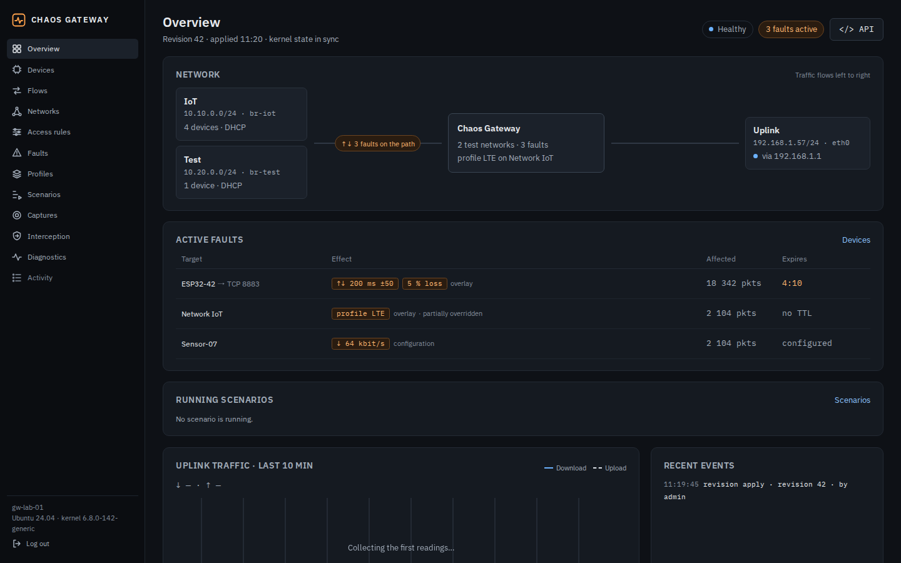
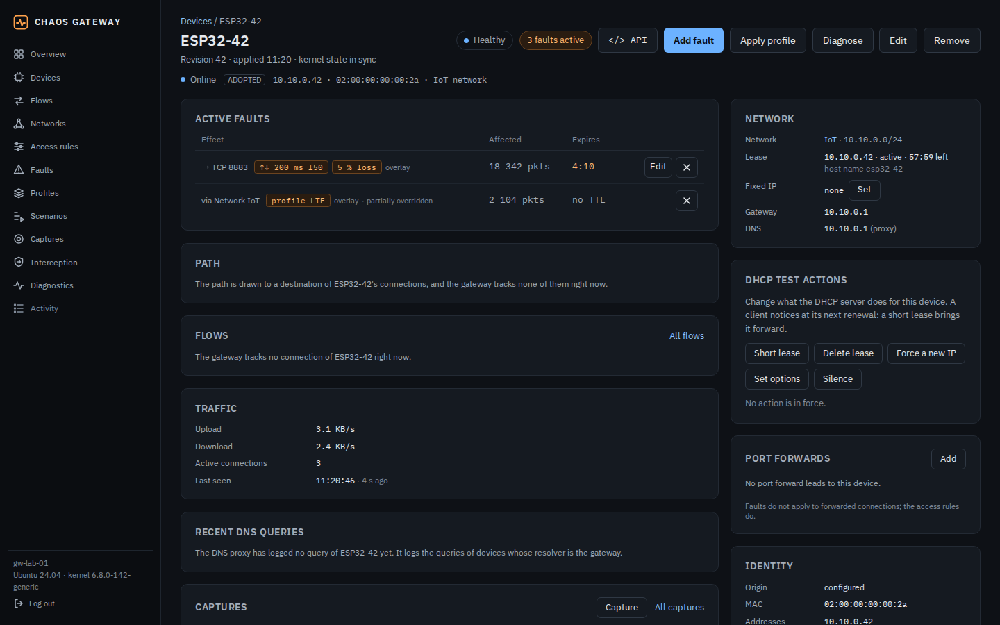
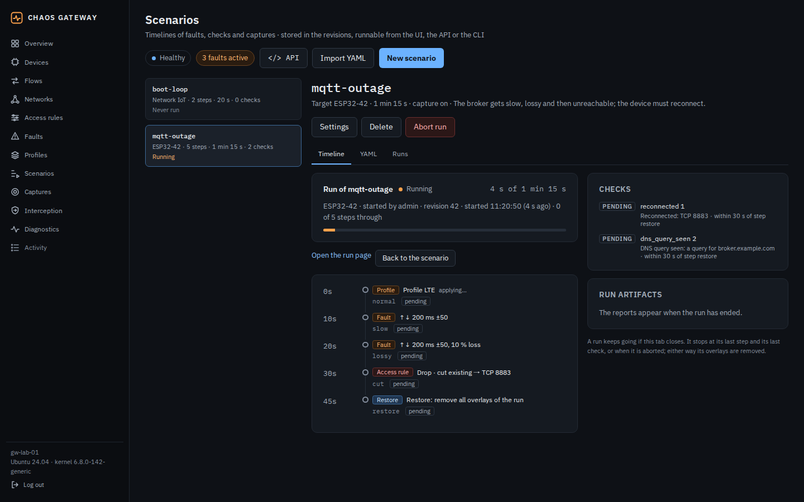
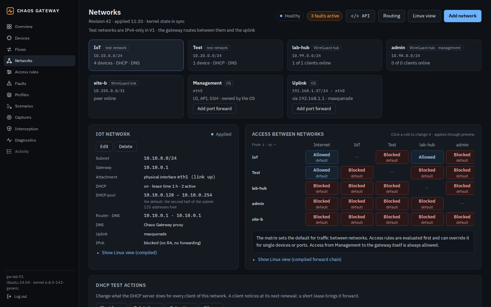

<p align="center"></p>

<h1 align="center">Chaos Gateway</h1>

<p align="center">A network gateway that breaks things on purpose, so you can see how your devices cope.</p>

---

Devices fail in the field when the network misbehaves: a slow mobile link, lost packets, a DNS server that lies, a certificate that
expires, a DHCP lease that changes. Chaos Gateway is a Linux box you put between your devices under test and the real network. It routes
their traffic like a normal gateway and lets you make exactly those things happen, per device, on demand and repeatably, while it
records what the device did.

It is built for firmware and IoT developers, QA and CI: plug the device into a test network, start a scenario, read the report.

| | |
|---|---|
|  |  |
| **Overview**: test networks, active faults, uplink traffic | **A device**: its faults, lease, DHCP test actions, traffic |
|  |  |
| **A scenario**: a timeline of faults with checks | **Networks**: test networks, WireGuard, access between them |

## What it can do

- **Be a gateway.** Routed test networks with NAT, DHCP (Kea) and a DNS proxy. Access rules between networks and per device (allow,
  drop, reject, TCP reset). Port forwarding. WireGuard hubs and links, with BGP, OSPF and Babel (BIRD).
- **Break the network.** Latency, jitter, loss, rate limits, reordering, duplication, corruption, blackouts, flapping, MTU and path MTU
  faults. Per device, group, network or for everything. Built-in profiles (LTE and others) and your own.
- **Break the protocols.** DNS faults, TLS certificate and handshake cases with a test CA, DHCP actions (short lease, deleted lease,
  new address, odd options), and time faults from the gateway's own NTP server (a clock a year ahead, 1970, 2038, a leap second, a
  kiss-of-death, no answer). Optionally an interception proxy that rewrites the HTTP exchanges of a device that trusts the test CA.
- **Run tests.** Scenarios are timelines of faults with checks ("the device must reconnect within 30 s"). A run leaves a JUnit and a
  JSON report, the events and, if you want, a packet capture. Faults can have a TTL, so nothing stays broken by accident.
- **Show what happened.** Packet captures (pcapng), counters per rule and fault, a live flow view, diagnostics from the gateway or from
  a virtual client, an audit log, Prometheus metrics.
- **Stay in control.** The configuration is a series of revisions: preview before you apply, and a change that touches the management
  interface has to be confirmed within 60 s or it rolls back. If a configuration does not apply, the gateway falls back to the last
  good one, or to a safe mode that keeps only the management interface. Stopping it removes everything it made from the kernel.
- **Be scripted.** A web app, a REST API with an OpenAPI spec, and `chaosctl` for the shell and CI, for example
  `chaosctl with --device esp32-42 --profile bad-lte -- pytest tests/`. Python and TypeScript clients are generated from the spec.

## Quick start

You need a host with Ubuntu 24.04 or 26.04 (x86-64 or ARM64), one network interface for the uplink and management, and one more per
test network. Everything runs as containers.

**Install.** Name the interface that will carry your first test network (`ip link` lists them; not the one you reach the host on):

```sh
curl -fsSL https://github.com/Andste82/chaos-gateway/releases/latest/download/install.sh | sudo sh -s -- --test-interface lan0
```

The script installs Docker if it is missing, pulls the image, prepares the host, starts the containers and waits until they are
healthy. It can be run again; if it stops, it says why (usually the OS still configures the test interface, for example in netplan).

**First configuration.** Open `https://<address of the host>:8443` in a browser (the certificate is the gateway's own, so the browser
warns). The wizard asks for the one-time setup token, which is in the log:

```sh
cd /opt/chaosgw && sudo docker compose logs api | grep 'Setup token'
```

Then give it the uplink, the management interface, your test interface and an admin password, and apply. The setup restricts the web
app to the management network and waits for your confirmation: if the browser cannot reach the gateway afterwards, it rolls back
and the wizard opens again. Connect a device to the test network, it gets its address from the gateway, and it shows up under
**Devices**.

**Update.**

```sh
sudo /opt/chaosgw/update.sh --token-file ~/chaosgw.token   # waits until no test run is active
sudo /opt/chaosgw/update.sh --check                        # shows what it would do
```

`--version X.Y.Z` picks a version. The token is an API token with the scope `read`; `--no-wait` updates at once and aborts running tests.

**Uninstall.**

```sh
sudo /opt/chaosgw/uninstall.sh           # stop it, clean the kernel, keep the data
sudo /opt/chaosgw/uninstall.sh --purge   # also delete the data, the files and the images
```

Next: the [user guide](docs/user-guide.md) walks through faults, scenarios and captures, and the
[cookbook](docs/cookbook.md) has recipes for the tests a device should survive.

## Limits

Test networks are IPv4 only; there are no VLANs yet, time faults reach a device only through plain NTP (not NTS, HTTP `Date` headers or a device's own clock) and not an NTP server inside the device's own network segments, and faults do not apply to connections that reach a
device through a port forward. The performance targets for a Raspberry Pi are not measured on real hardware yet
([#151](https://github.com/Andste82/chaos-gateway/issues/151)). The interception proxy has no supported screen in the web app yet; use the API or
`chaosctl`.

## Documentation

| | |
|---|---|
| [Installation](docs/install.md) | the scripts, the host, HTTPS certificate, port forwarding, captures, metrics |
| [User guide](docs/user-guide.md) | concepts, the web app, faults, scenarios, captures, probes, `chaosctl` |
| [Cookbook](docs/cookbook.md) | scenario recipes |
| [API guide](docs/api-guide.md), [`api/openapi.yaml`](api/openapi.yaml) | the REST API with examples, and its spec |
| [Troubleshooting](docs/troubleshooting.md), [Recovery](docs/recovery.md) | preflight checks, safe mode, a lost password, a bad update |
| [Development](docs/development.md), [Plan](docs/plan.md) | build, tests, CI, architecture and decisions |

## License

MIT, see [`LICENSE`](LICENSE).
